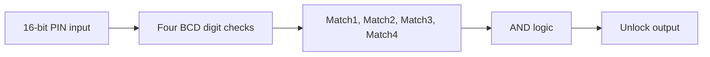

# Digital Combination Lock Using VHDL

## Project Overview

This project uses VHDL to design and simulate a digital combination lock in Quartus II 13.0.

The goal is to make a lock that checks an entered password and produces an `Unlock` signal when the combination is correct. I'm building it in stages rather than trying to make the full system at once. I started with a simple 4-bit binary password and am now moving toward a four-digit decimal password using Binary-Coded Decimal (BCD).

I also want to try implementing parts of the design using NAND gates. Since NAND gates are universal gates, it would be interesting to compare a gate-level version with the simpler VHDL implementation.

## Personal Motivation

This is one of my first independent Quartus projects using VHDL outside of university coursework. I started it to get more comfortable with Quartus and GitHub while getting some hands-on practice with digital logic.

What I like about doing this outside of a lab is that there isn't a set list of instructions to follow. I have to decide what to add next, work out how the circuit should behave, and figure out why something isn't working when I test it. I want to get better at writing VHDL and understanding how the smaller parts of a digital circuit fit together.

## Tools

| Tool | What I'm using it for |
|---|---|
| Quartus II 13.0 | Creating and compiling the digital design |
| VHDL | Describing the logic for the lock |
| Quartus Waveform Editor (`.vwf`) | Generating inputs and checking the resulting outputs |
| GitHub / GitHub Desktop | Saving versions of the project and documenting changes |

## Stage 1 — 4-Bit Binary Password Checker

I started with a 4-bit input, `PIN_Input(3 DOWNTO 0)`, and one output, `Unlock`.

The first password was `1011`. The logic was straightforward: `Unlock` should be `1` when the input is `1011` and `0` for every other input. I used the Waveform Editor's counting feature to generate different binary combinations instead of entering each one manually.

This first version is combinational. It checks whatever value is currently on the input; it doesn't remember previous entries or wait for an Enter button.

## Stage 2 — Four-Digit BCD Password Checker

I'm now expanding the input to `PIN_Input(15 DOWNTO 0)`, which gives me 16 bits in total. Every four bits represent one decimal digit, so the password can be written as a normal four-digit number rather than a single binary value.

For this version, the password is **4832**.

| Decimal digit | BCD bits | Input bit positions |
|---|---|---|
| 4 | `0100` | 15–12 |
| 8 | `1000` | 11–8 |
| 3 | `0011` | 7–4 |
| 2 | `0010` | 3–0 |

Full 16-bit password: `0100 1000 0011 0010`

Instead of checking the full input with an `IF` statement, I wrote separate Boolean expressions using `AND` and `NOT` for the four digits. Each expression generates a match signal, and all four signals need to be high to unlock the system.

$$
Unlock = Match_1 \cdot Match_2 \cdot Match_3 \cdot Match_4
$$

### Current Circuit Layout

At the moment, all four digits are provided at the same time. The circuit isn't yet a keypad-style lock where you enter one digit after another.

### Simulation Tests

I'm using the waveform editor to check passwords close to `4832`, then I want to test a wider range of inputs.

One issue I ran into while planning the tests is that ordinary hexadecimal counting also includes A–F, which aren't valid BCD digits. A future testbench would let me test exactly `0000` through `9999` without those invalid combinations.

| Input shown in hex radix | Expected Unlock | Reason |
|---|---|---|
| `4831` | 0 | Last digit is wrong |
| `4832` | 1 | All four digits match |
| `4833` | 0 | Last digit is wrong |
| `0000` | 0 | Incorrect password |
| `483A` | 0 | Invalid BCD digit |

These are the expected results. I still need to confirm the Stage 2 functional simulation before marking it complete.

## What I Want to Add Next

| Stage | Goal | Status |
|---|---|---|
| 1 | Check a 4-bit binary password (`1011`) | Initial design written; waveform created |
| 2 | Check a four-digit BCD password (`4832`) | Code written; simulation verification in progress |
| 3 | Enter decimal digits one at a time and store them | Planned |
| 4 | Add an Enter button, clock, reset, and control logic | Planned |
| 5 | Count incorrect attempts and lock out after three failures | Planned |
| 6 | Add seven-segment display outputs | Planned |
| 7 | Compare the comparator with a NAND-only version | Optional experiment |

The part I'm most interested in next is getting the lock to remember digits as they're entered. That will mean moving beyond combinational logic and working with registers, clocks, and a finite-state machine (FSM).

## Project Files

| File | Purpose |
|---|---|
| `combonationLock.vhd` | Main VHDL design |
| `passkey1.vwf` | Original 4-bit test waveform |
| `combonationLock.qpf` | Quartus project file |
| `combonationLock.qsf` | Quartus project settings |

The updated 16-bit waveform can be kept as a separate `.vwf` file so the Stage 1 test is still available.

## Project Status

**Stage 2 — BCD Password Checking and Simulation Testing**

The current focus is on verifying that the four-digit password checker works correctly. Once the simulation is confirmed, the next step is to implement sequential logic so that digits can be entered and stored individually.