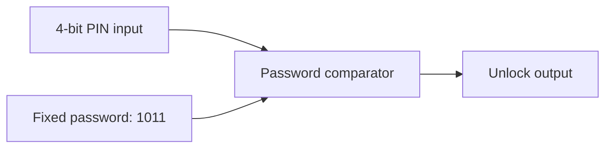
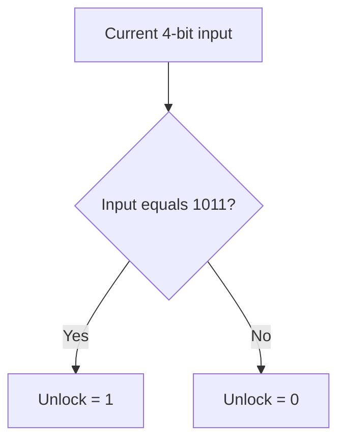

# Digital Combination Lock Using VHDL

## Project Overview

This project uses VHDL to design and simulate a digital combination lock in Quartus II 13.0. The main goal is to build a system that checks an entered password and produces an unlock signal when the combination is correct.

I'm developing the project in stages, starting with a simple 4-bit binary password checker and gradually working toward a lock that accepts multi-digit decimal PINs (0–9). I also want to explore implementing the password-checking logic using only 2-input NAND gates to better understand how basic gates can be combined into more complex circuits.

## Personal Motivation

This is one of my first independent Quartus projects using VHDL outside of university coursework. I started it to get more comfortable with Quartus and GitHub while improving my digital logic design skills.

As I work on the project, I want to become better at writing VHDL, testing circuits, and understanding how different logic components work together.

## Software Used

| Tool | Purpose |
| --- | --- |
| Quartus II 13.0 | Writing and compiling the VHDL design |
| VHDL | Describing the circuit's digital logic |
| Quartus Vector Waveform Editor (`.vwf`) | Creating test inputs and viewing simulated outputs |
| GitHub and GitHub Desktop | Tracking changes and documenting progress |

## Stage 1 — 4-Bit Password Checker

The first stage is a combinational password checker. It compares a 4-bit input to the fixed binary combination `1011` and sets `Unlock` to `1` only when they match.

### Inputs and Outputs

| Signal | Width | Description |
| --- | --- | --- |
| `PIN_Input[3..0]` | 4 bits | Entered binary combination |
| `Unlock` | 1 bit | `1` for a match; `0` otherwise |

### Circuit Block Diagram



### Boolean Logic

Let $A_3$, $A_2$, $A_1$, and $A_0$ represent the input bits, from most significant to least significant. The unlock condition is:

$$
\mathrm{Unlock} = A_3\overline{A_2}A_1A_0
$$

This means that the input must be `1011`: bit 3 is `1`, bit 2 is `0`, and bits 1 and 0 are both `1`.

The current VHDL design expresses the same comparison as:

```vhdl
Unlock <= '1' WHEN PIN_Input = "1011" ELSE '0';
```

The design is **combinational**, so the output follows the current input. At this stage, there is no clock, Enter button, or memory of previous attempts.

### Password-Checking Logic



This flowchart describes the comparison logic, not a sequence of clocked operations.

## Simulation and Testing

The test waveform is saved as `passkey1.vwf`. The input is set to cycle through all 16 possible 4-bit values, allowing the comparator to be checked against every possible combination.

### Expected Results

| `PIN_Input` | Expected `Unlock` | Lock state |
| --- | --- | --- |
| `0000` | `0` | Locked |
| `0101` | `0` | Locked |
| `1010` | `0` | Locked |
| `1011` | `1` | Unlocked |
| `1111` | `0` | Locked |

The expected behaviour is that **only `1011` produces `Unlock = 1`**. The table shows selected test cases; the waveform covers all 16 combinations.

**Simulation status:** The input waveform has been prepared. Functional simulation results still need to be verified and documented.

After verifying the simulation, I'll add a screenshot of the waveform here to show the correct input and output behaviour.

## Development Roadmap

| Stage | Planned feature | Status |
| --- | --- | --- |
| 1 | 4-bit password comparator and simulation | In progress |
| 2 | Clock, reset, and Enter button | Planned |
| 3 | Multi-digit decimal PIN entry and storage | Planned |
| 4 | Incorrect-attempt counter and lockout | Planned |
| 5 | Seven-segment display output | Planned |
| 6 | NAND-only password comparator | Planned |

As the project grows, I plan to use registers and a finite-state machine (FSM) to manage the lock's states. I'll also compare the original password checker with a NAND-only version to see how the designs differ in structure and complexity.

## Project Files

| File | Description |
| --- | --- |
| `combonationLock.vhd` | Main VHDL source file |
| `passkey1.vwf` | Test waveform |
| `combonationLock.qpf` | Quartus project file |
| `combonationLock.qsf` | Quartus project settings |

*File names are shown as used in this project; their capitalization may differ in the repository.*

## Project Status

**In development — Stage 1: 4-bit binary password checker.**

The next step is to verify the functional simulation and save the results before adding sequential logic.
